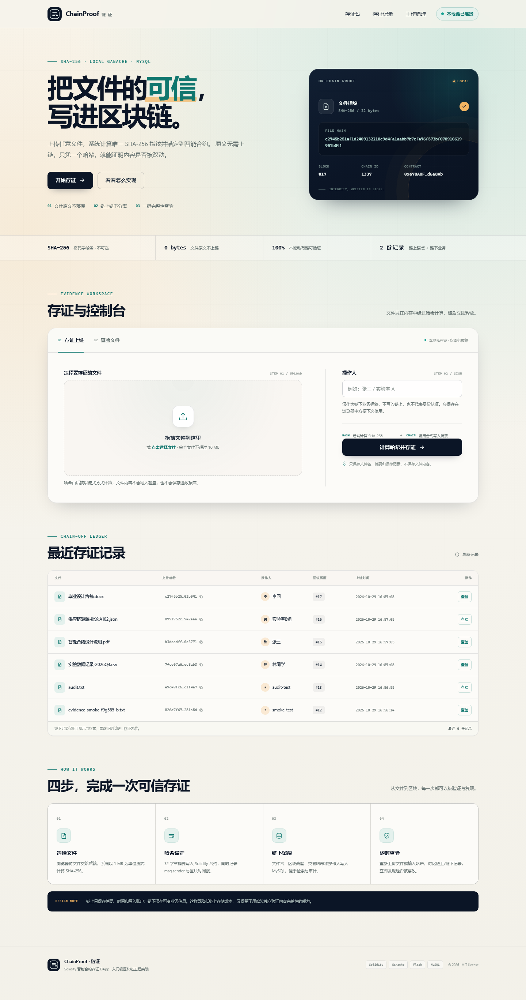
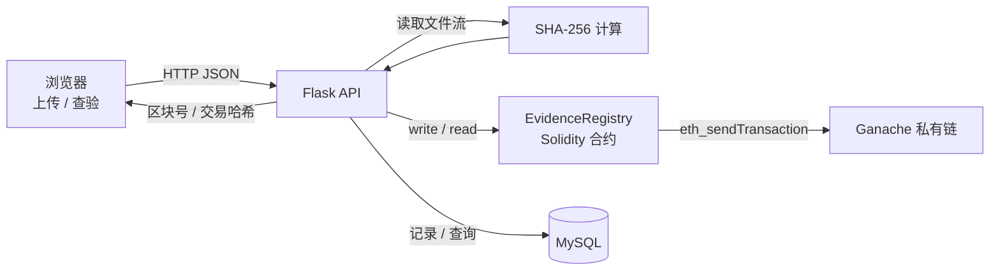

# Solidity 智能合约存证 DApp

一个用于学习与演示的入门级区块链存证项目：文件只计算 SHA-256 摘要，摘要写入本地 Ganache 私有链，文件名、区块高度、操作人等业务信息保存在 MySQL，前端可上传文件并查验是否被篡改。


> 本项目仅用于学习演示，未实现账号体系、权限控制与生产级高可用，请勿直接用于真实资产或法律存证场景。

## 界面预览



## 功能

- 拖拽/选择文件，后端流式计算 SHA-256（不落盘保存原文件）
- 调用 Solidity 合约写入存证哈希、链上时间戳与写入账户
- MySQL 保存文件名、哈希、交易哈希、区块高度、操作人、链上时间
- 上传指定文件或输入哈希，查验链上/链下记录是否一致
- 最近存证记录列表与服务健康状态展示
- 前后端分离，前端只依赖原生 HTML/CSS/JavaScript

## 项目亮点

- **密码学哈希**：仅凭 SHA-256 指纹判断内容完整性，哈希单向不可逆，文件无法从摘要还原。
- **链上链下分离**：链上只存 32 字节摘要与时间戳，业务元数据放 MySQL，降低链上成本。
- **以链上为准的查验**：同时比对链上 owner/timestamp 与链下记录，能识别“只改了数据库”的情况。
- **完整工程链路**：文件上传 → 哈希计算 → 合约写链 → 交易回执 → 链下落库 → 前端可视化查询。

## 技术栈

| 层 | 技术 |
| --- | --- |
| 智能合约 | Solidity 0.8.19 |
| 本地链 | Ganache CLI / Ganache UI（HTTP-RPC，默认 `7545`） |
| 后端 | Python 3.10+、Flask、web3.py |
| 前端 | 原生 HTML + CSS + JavaScript |
| 数据库 | MySQL 8.0+（`mysql-connector-python`） |
| 合约工具 | solc（Node.js 包，仅编译时需要） |

## 架构



链上只保存 32 字节哈希、写入地址和时间戳；文件名、操作人等可变或隐私数据放链下 MySQL。这种“链上存证、链下存业务”的拆分可以减少链上存储成本，并让摘要成为可独立验证的可信锚点。

## 目录结构

```text
solidity-evidence-dapp/
├── contracts/EvidenceRegistry.sol   # 存证合约
├── artifacts/EvidenceRegistry.json  # 已编译 ABI + bytecode
├── scripts/
│   ├── compile.js                   # solc 编译脚本
│   ├── deploy.py                    # 部署合约到 Ganache
│   └── smoke_test.py                # 跑通后的端到端冒烟测试
├── backend/
│   ├── app.py                       # Flask 应用工厂与错误处理
│   ├── config.py                    # 环境配置
│   ├── chain.py                     # 合约调用
│   ├── db.py                        # MySQL 数据访问
│   ├── routes.py                    # REST API
│   ├── service.py                   # 存证业务编排
│   ├── utils.py                     # 哈希、校验工具
│   └── errors.py
├── frontend/                        # 独立静态前端
│   ├── index.html
│   ├── app.js
│   ├── config.js
│   └── styles.css
├── database/init.sql                # 数据库、用户、表结构（开发用）
├── tests/                           # 不依赖外部服务的单元测试
├── docs/API.md
├── .env.example
└── README.md
```

## 快速开始

### 0. 前置条件

- Python 3.10+
- Node.js 18+（安装 Ganache / solc 工具）
- MySQL 8.0+
- 本地 Ganache，监听 `http://127.0.0.1:7545`

### 1. 启动 Ganache

推荐用 CLI，固定助记词方便每次启动后地址一致：

```bash
npm install
npm run chain
```

也可以使用 Ganache UI：新建工作区，端口设为 `7545`，Chain ID 设为 `1337`。

### 2. 初始化 MySQL

先修改 `database/init.sql` 中两处开发密码（默认 `evidence_demo_pwd`），然后用管理员账号执行：

```bash
# macOS / Linux / Git Bash
mysql -u root -p < database/init.sql
```

```powershell
# Windows PowerShell
cmd /c "mysql -u root -p < database\init.sql"
```

该脚本会创建数据库 `evidence_dapp`、应用账号 `evidence_app` 和两张表。若你使用已有数据库/账号，也可以只执行建表部分，并同步修改 `.env`。

### 3. 安装 Python 依赖并配置环境

```bash
python -m venv .venv
# Windows PowerShell
.venv\Scripts\Activate.ps1
# macOS / Linux
# source .venv/bin/activate

pip install -r requirements.txt
copy .env.example .env   # Windows；macOS/Linux 用 cp
```

按本机实际情况修改 `.env`。**不要提交 `.env`。**

### 4. 编译并部署合约

```bash
npm run compile   # 修改合约后重新编译；仓库已附带成品 artifacts
python scripts/deploy.py
```

部署成功后会生成 `deployments/ganache.json`，后端会自动读取其中的合约地址，无需手改 `.env`。

### 5. 启动后端

```bash
python run.py
```

API 默认地址：`http://127.0.0.1:5000/api`

### 6. 启动前端

另开一个终端：

```bash
cd frontend
python -m http.server 8080
```

打开 `http://127.0.0.1:8080`。若后端地址或端口有变化，修改 `frontend/config.js` 中的 `API_BASE`，然后重启静态服务器。

## 使用流程

1. 在“存证上链”中拖入文件，填写操作人（仅作为链下业务字段，不是登录身份）。
2. 点击“计算哈希并存证”。后端计算 SHA-256，先检查是否已存在，再发起合约交易，最后写入 MySQL。
3. 成功后页面显示 SHA-256、交易哈希、区块高度、链上时间与写入账户。
4. 在“查验文件”中重新上传同一文件（或粘贴哈希）点击查验：
   - 链上、链下都存在且一致：显示“通过，文件未被篡改”
   - 未找到哈希：文件可能未存证，或内容已经改变
   - 仅有链上或仅有链下：提示数据不一致，需要排查
5. 下方“最近存证记录”展示 MySQL 中的记录，点击“查验”可载入对应哈希。

也可以用 curl：

```bash
curl -F "file=@README.md" -F "user_name=demo" http://127.0.0.1:5000/api/evidence
curl -F "file=@README.md" -F "user_name=demo" http://127.0.0.1:5000/api/verify
```

## API

| 方法 | 路径 | 说明 |
| --- | --- | --- |
| POST | `/api/evidence` | `multipart/form-data`：`file`、`user_name`，写入存证 |
| POST | `/api/verify` | `file` 或 JSON `{ "hash": "..." }`，查验记录 |
| GET | `/api/evidence/<hash>` | 查询指定哈希的链上/链下信息 |
| GET | `/api/records?limit=10` | 最近存证记录 |
| GET | `/api/health` | 链、数据库、合约连接状态 |

完整字段与错误码见 [docs/API.md](docs/API.md)。

## 测试

```bash
pip install -r requirements-dev.txt
pytest
```

默认测试使用替身对象，不需要启动 Ganache/MySQL。需要真实联调时，分别启动 Ganache、MySQL、部署合约、启动后端，然后：

```bash
python scripts/smoke_test.py --api http://127.0.0.1:5000/api --file README.md
```

真实链集成测试默认跳过，启动 Ganache 后可运行：

```bash
# PowerShell
$env:RUN_CHAIN_TESTS="1"; pytest -m integration
# macOS / Linux
RUN_CHAIN_TESTS=1 pytest -m integration
```

### 本机验证记录

- 后端单元/API 测试：`27 passed, 3 skipped`
- Ganache 合约集成测试：`3 passed`
- 端到端冒烟测试：上传、链上写入、MySQL 落库、文件查验全部通过
- 环境：Windows 11、Python 3.12、MySQL 8.0.46、Ganache 7.9.2、Node.js 24

## 设计说明与安全边界

- **只存哈希，不存原文**：原文件不落盘；哈希用于证明内容完整性，不提供文件恢复能力。
- **严格说哈希不是加密**：SHA-256 是单向摘要函数，无法“解密”回原文件；项目展示的是哈希的抗篡改与抗碰撞特性，而不是可逆加密。
- **链上/链下分离**：链上负责不可篡改的存在性与时间证明，MySQL 保存业务元数据。链下数据库不是信任源，一致性以链上为准。
- **“未被篡改”的含义**：如果重新上传的文件哈希命中链上记录，说明文件内容与存证时一致；如果链下元数据被修改，查验会提示链上链下不一致。
- **操作人字段不是身份认证**：本项目没有登录与签名流程，`user_name` 只是业务标签。生产系统应加入钱包签名、OAuth/JWT、操作审计和最小权限控制。
- **写入账户**：后端使用 Ganache 解锁的第 1 个账户发起交易；不要把真实私钥写进仓库或浏览器。
- **重复存证**：同一 SHA-256 不允许重复写入。链上交易成功后若 MySQL 写入失败，可能出现“链上存在、链下缺失”；这是有意优先保证链上锚定，可通过哈希重新查验并在日志中排查。

更多设计取舍、演示讲解要点与限制见 [docs/DESIGN.md](docs/DESIGN.md)。

## 常见问题

**页面显示“后端未连接”**  
确认后端 `http://127.0.0.1:5000/api/health` 可访问，前端端口是 `8080`，且 `frontend/config.js` 的 API 地址正确。跨域来源可在 `.env` 的 `CORS_ORIGINS` 中配置。

**`尚未部署合约` / `CONTRACT_ADDRESS 为空`**  
先在 Ganache 启动后运行 `python scripts/deploy.py`。重启 Ganache 后链上数据会清空，需要重新部署并重新存证。

**`无法连接 MySQL` / `Access denied`**  
检查 MySQL 服务、`.env` 中的账号密码、`database/init.sql` 是否已执行。不要使用含有未转义特殊字符的密码。

**`npminstall` 失败或 Ganache 启动报错**  
确认 Node.js 版本满足要求，并允许 npm 访问网络。也可以改用 Ganache UI，手动设置 RPC 地址、端口和 Chain ID。

## License

[MIT](LICENSE)
