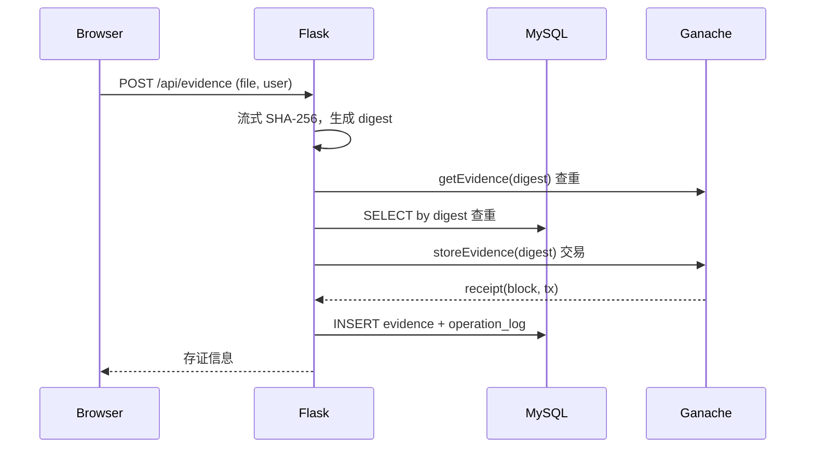

# 设计说明

## 1. 目标与边界

项目目标是用尽量小的工程规模，完整演示一条“文件哈希上链 + 链下业务记录 + 前端查验”的可信链路，适合作为入门级区块链课程设计或面试展示。

它解决的是**内容完整性证据**问题：给定一个文件，能否证明它在某个时间点存在、且之后没有被修改。它不解决文件保密、文件存储、数字签名身份认证、法律效力等问题。

## 2. 为什么链上只存哈希

| 方案 | 优点 | 缺点 |
| --- | --- | --- |
| 文件原文上链 | 数据完全链上，理论上最直接 | 成本高、隐私差、大文件不可行 |
| 链上存哈希 | 固定 32 字节、隐私友好、计算和验证简单 | 原文件需另行保存，哈希本身不可逆 |
| 链下数据库存一切 | 成本低、查询方便 | 数据库管理员可以随意修改，无法自证 |

因此采用“哈希锚定 + 链下存业务元数据”的组合：

```text
链上：fileHash → (owner, timestamp)
链下：fileHash → (fileName, userName, blockNumber, txHash, chainOwner, chainTimestamp)
```

链上数据是信任根，链下数据用于查询与展示。查询时不能只看数据库，必须同时读取合约并核对链上 owner/timestamp。

## 3. 合约设计

```solidity
struct Evidence {
    address owner;
    uint256 timestamp;
    bool exists;
}
mapping(bytes32 => Evidence) private _evidence;
```

- `storeEvidence(bytes32)`：写入摘要，`msg.sender` 作为写入账户，`block.timestamp` 作为时间戳；同一摘要第二次写入直接 revert。
- `getEvidence(bytes32)`：返回 `exists/owner/timestamp`。
- `verifyEvidence(bytes32)`：只返回是否存在，供轻量查询。
- `EvidenceStored` 事件：便于后续做 The Graph、区块浏览器或日志审计扩展。
- `totalEvidence`：存证总数，方便演示。

SHA-256 摘要在 Python 中以 64 位十六进制出现，传入合约前转为 `bytes32`：

```python
bytes.fromhex(digest)  # 32 bytes
```

## 4. 存证流程与一致性



设计选择是“先上链，再落库”，优先保证链上锚定成功。代价是极小概率出现“链上成功、MySQL 失败”的短暂不一致：

- 接口会返回 `500 CHAIN_WRITTEN_DB_FAILED`，并在 `detail` 中带 `tx_hash` 与 `block_number`；
- 重新上传同一文件会得到 `409`，`detail` 显示链上记录存在但链下缺失；
- 运维人员可以根据哈希和交易哈希修复数据库记录。

这是教学项目中刻意保留并写清楚的工程折中。生产系统通常需要 outbox、重试队列、幂等键和监控告警。

## 5. 查验状态机

| 链上 | 链下 | 状态 | 结论 |
| --- | --- | --- | --- |
| 有 | 有，owner/timestamp 一致 | `verified` | 文件完整，记录一致 |
| 有 | 有，元数据不一致 | `inconsistent` | 文件本身完整，但链下记录被改过 |
| 有 | 无 | `chain_only` | 完整性成立，业务记录丢失 |
| 无 | 有 | `db_only` | 不能信任数据库，疑似篡改 |
| 无 | 无 | `not_found` | 从未存证或文件已改变 |

前端用三种颜色区分：绿色通过、黄色注意、红色高风险。

## 6. 哈希计算为什么放在后端

需求明确要求“后端自动计算文件哈希”。后端 `hash_stream` 以 1 MB 分块读取上传流：

- 不把文件整体读进内存，适合大文件；
- 不写入临时文件，不保留原文；
- 超限时立即抛出 `413`；
- 数据库只保存文件名与哈希，不存文件内容。

前端在上传时只展示进度，不自行决定上链哈希，避免信任客户端。

## 7. 安全与工程实践

已实现：

- 文件路径剥离（不信任上传文件名，不落盘）；
- 哈希格式、操作人长度、文件大小校验；
- SQL 参数化查询，避免字符串拼接注入；
- 错误统一封装，不向前端暴露堆栈；
- `.env` 忽略，仓库不包含密码/私钥；
- 链下用户字段明确标注“非身份认证”；
- 合约重复写入保护；
- 健康检查与结构化日志；
- API 与前端分离，CORS 可配置。

尚未实现（可继续扩展）：

- 钱包签名/账户体系（当前写入账户是后端解锁的 Ganache 账户）；
- 文件加密存储或 IPFS 存储；
- 合约升级、权限控制和暂停开关；
- 多链、区块重组处理和交易重试；
- 生产级数据库迁移、监控与限流；
- 对 XSS/CSRF 的完整企业级防护。

## 8. 演示讲解脚本（约 3 分钟）

1. **开场**：文件存证要解决“内容在某个时间存在且未被改”，难点在于原文不能昂贵地上链。
2. **上传**：拖入文件，后端只算 SHA-256，不保存原文；展示进度条和结果。
3. **看链上**：指出交易哈希、区块高度、链上写入账户、时间戳；强调这些字段来自 Ganache 回执与合约查询。
4. **看链下**：MySQL 保存文件名、操作人和区块高度，方便检索，但不是信任源。
5. **正常查验**：重新上传同一文件，状态为绿色“验证通过”。
6. **篡改查验**：修改文件内容再上传，哈希改变，状态为 `not_found`，说明哈希的雪崩效应。
7. **异常演示（可选）**：直接改数据库中某条记录的 `chain_owner`，刷新查验，状态变为 `inconsistent`，说明为什么不能只信数据库。
8. **收尾**：重申链上链下分离、密码学哈希的不可逆性，以及当前项目作为教学 Demo 的边界。

## 9. 可扩展方向

- 用 IPFS 保存加密后的原始文件，链上再加 CID；
- 接入 MetaMask，让用户自己签名写入，解决“后端代写”身份问题；
- 使用 EIP-712 结构化签名做离线授权与批量存证；
- 用 Docker Compose 一键启动 MySQL + Ganache；
- 为合约写 Foundry/Hardhat 测试，加入覆盖率与 CI；
- 用索引器读取事件，重建链下视图，减少对中心化数据库的依赖。
